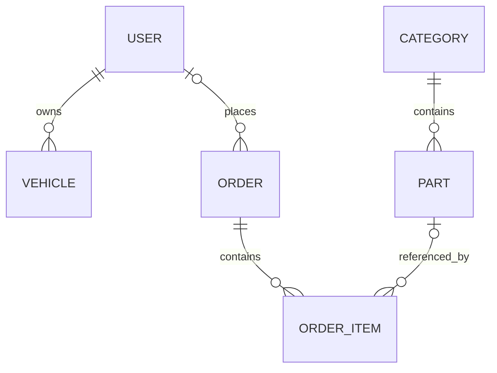

# BimmerHub

BimmerHub is a Django application for browsing BMW parts, managing a
personal vehicle garage and ordering parts for delivery within Ireland.
Delivery is charged at a fixed rate of €30 per order.

The application is deployed on Heroku and uses Stripe's sandbox only.
Successful payment, resume and cancellation journeys were manually verified
on the deployed site on 12 November 2026. No real money is taken.

## Purpose and audience

BimmerHub is an educational e-commerce application for BMW owners looking
for parts delivered within Ireland. Visitors can search the catalogue and
inspect product information before registering. Registered customers can
manage vehicle records, submit delivery details, pay through Stripe sandbox
Checkout and revisit their orders. The owner's proposed revenue comes from
parts sales; no real money is taken in this assessment project.

The personal garage provides vehicle-record CRUD alongside the purchasing
journey. It does not automatically guarantee product compatibility: customers
must check the product's stated compatible model and part number.

Source repository: [BimmerHub on GitHub](https://github.com/darrio-dk08/bimmerhub_project).
Deployed site: [BimmerHub](https://bimmerhub-dk08-d54befa6cdf3.herokuapp.com/).
Heroku app: `bimmerhub-dk08`. Release `v16` deployed commit `a2f7492c`
on 12 November 2026 at 17:55:30 UTC. This matched local `main`,
`origin/main` and `heroku/main` at verification; the working tree was clean.
The deployment record identifies the tested release, not later documentation commits.

## Contents

- [User stories and access](#user-stories-and-access)
- [UX and interface design](#ux-and-interface-design)
- [Technology and architecture](#technology-and-architecture)
- [Database schema](#database-schema)
- [Local setup](#local-setup)
- [Deployment procedure](#deployment-procedure)
- [Security and payment integrity](#security-and-payment-integrity)
- [Bugs and fixes](#bugs-and-fixes)
- [Current development status](#current-development-status)
- [Testing](#testing)
- [Credits](#credits)

## User stories and access

These stories describe the implemented application as reviewed during
resubmission preparation. They are not presented as a dated original plan.

| User goal | Implementation | Evidence and limits |
| --- | --- | --- |
| As a visitor, I want to find suitable parts before creating an account. | Public catalogue, search by name/part number/model, category filter and detail pages. | Core and parts automated tests; complete production link audit outstanding. |
| As a customer, I want to register and sign in securely. | Allauth forms, validation, anonymous-only login/signup and confirmed logout. | 15 authentication regression tests and local browser checks. |
| As a customer, I want to maintain my vehicle details. | Create, list, edit and delete my own garage records. | Garage validation and ownership tests; deployed CRUD and two-account checks passed on 12 November 2026. |
| As a shopper, I want to control quantities and see the full cost. | Basket updates/removal, stock checks and fixed EUR 30 delivery. | Basket and checkout tests; deployed payment and mobile basket checks passed. |
| As a customer, I want to review my address and price before paying. | Ireland-only form, review and server-side comparison of reviewed amounts. | Checkout form, view and connection tests. |
| As a customer, I want clear payment results and a safe retry. | Stripe Checkout, verification, pending/paid/cancelled feedback, resume and cancellation. | Payment service tests plus successful, declined/retry and expiry browser/API checks. |
| As a customer, I want to find previous orders. | Private order history and saved order details. | 16 order-page tests plus local and deployed order-history and ownership checks. |
| As authorised staff, I want to inspect purchases without changing payment evidence. | Read-only order admin with search and filters. | 12 admin tests and local manual checks. |

Visitors can browse and maintain a session basket. Authentication is required
for checkout, garage records and customer order history. Customers cannot
read another customer's orders or change their vehicles. Staff must have
appropriate Django permissions for admin access; customer pages remain
scoped to their owner even when that owner is a superuser.

## UX and interface design

The interface uses a shared header, footer, typography and styling through
`core/templates/base.html`. A dark blue visual theme and consistent buttons
connect catalogue, basket, account and checkout pages. The primary journey is
catalogue > product > basket > delivery form > review > Stripe > payment status.
My orders provides a route back to purchases after leaving confirmation.

Design choices visible in the implementation:

- Visitors can inspect products before being asked to register.
- Delivery is shown before payment, rather than added only at Stripe.
- Editable vehicle forms use validation and success/error messages.
- A skip link, semantic navigation, labelled menu control and visible keyboard
  focus support navigation without a mouse.
- The custom JavaScript in `core/static/core/js/navigation.js` adapts the menu
  to a 600px breakpoint, updates its expanded state, closes it on Escape and
  manages focus when the layout changes.
- Order references wrap and checkout/order layouts adapt to narrow screens.
- A payment return URL alone cannot establish payment success or cancellation.
  The interface distinguishes awaiting payment from confirmed payment.

Local keyboard and responsive account-page checks are recorded below.
A full contrast/accessibility audit, rendered HTML/CSS validation, JavaScript
linting and browser-console review remain to be recorded. No Lighthouse score
or accessibility conformance level is claimed without a measured result.

No original wireframes have been supplied for this documentation update.
Any diagrams or screen plans added during resubmission should be labelled as
current-design documentation rather than retrospectively claimed planning.
The footer currently links to general social-network homepages; those
links are not verified BimmerHub social accounts and need a final content review.

## Technology and architecture

| Component | Role |
| --- | --- |
| Python / Django 5.2.14 | Models, forms, views, templates, sessions and permissions |
| HTML, CSS and custom JavaScript | Server-rendered responsive interface and mobile navigation |
| django-allauth | Registration, username/password login and logout |
| SQLite | Default local development database and current automated test database |
| PostgreSQL via `DATABASE_URL` | Persistent Heroku production database connection |
| Stripe Python 15.1.0 / hosted Checkout | Sandbox payments and verified webhook processing |
| WhiteNoise | Compressed, manifest-based static files |
| Cloudinary | Persistent production product images |
| Gunicorn / Heroku | Production WSGI process and hosting |
| Git / GitHub | Version control and development history |

Exact dependency versions are in `requirements.txt`; the deployment Python
version is specified in `.python-version`. Local checks were run with Python
3.11.3 on Windows and the same suite was also run with Python 3.12.

| App | Responsibility |
| --- | --- |
| `core` | Homepage, base layout, shared CSS and navigation JavaScript |
| `accounts` | Custom allauth templates and authentication regression tests |
| `parts` | Categories, products, catalogue search/filter and product detail |
| `garage` | Customer-owned vehicle records and validated CRUD |
| `payments` | Basket, checkout, orders, reservations, Stripe services, webhooks and order history/admin |

Configuration is centralised in `bimmerhub/settings.py` and reads environment
variables. HTTP views coordinate forms and responses; payment service modules
encapsulate transactions and external API handling; model fields and database
constraints enforce stored-data rules. Templates render data rather than
calculate trusted payment amounts. There is no custom UserProfile model in
the current code: accounts use Django's built-in user and allauth models.

## Database schema

The diagram covers the application's principal entities; Django/allauth also
provide authentication, email-address, session, site and permission tables.
A basket is stored in the Django session, not a custom Basket model.



| Model | Fields and purpose | Relationships and deletion behaviour |
| --- | --- | --- |
| `Vehicle` | ID, make, model, year, engine, optional registration. Form limits year to 1886 through next year. | Required user FK; deleting that user cascades to their vehicles. |
| `Category` | ID and unique name. | One category has many parts. Deleting a category cascades to its parts. |
| `Part` | ID, name, description, unique part number, compatible-model text, decimal price, stock, optional image, created/updated timestamps. | Required category FK. Compatibility is descriptive text, not a vehicle FK. |
| `Order` | ID, unique UUID reference, customer/delivery snapshot, currency, delivery cost, total, status, timestamps and payment/reservation fields. | Nullable user FK with SET_NULL; deleting a user preserves their order snapshot. |
| `OrderItem` | ID, saved product name, part number, decimal unit price and quantity. Computed subtotal is unit price multiplied by quantity. | Required order FK with CASCADE; nullable part FK with SET_NULL, preserving history when a product is deleted. |

Order delivery fields are `full_name`, `email`, `phone`, `address_line1`,
`address_line2`, `town_or_city`, `county`, `postal_code` and `country`.
Checkout validates Irish delivery; stored currency is `eur`.

Payment fields are `stripe_checkout_session_id`, `stripe_payment_intent_id`,
`checkout_token`, `stock_reserved` and `stripe_checkout_request`. Session and
PaymentIntent identifiers and checkout tokens are nullable and unique.
The saved JSON request supports identical Stripe retries after uncertain
network or database outcomes. It is not a store of card numbers or CVCs.

Database constraints reject negative order totals or delivery charges,
orders whose total is less than delivery, negative item unit prices, and
item quantities outside 1–999. The order service calculates totals from the
database and stores product snapshots. `items_subtotal` is the saved order
total minus delivery. Cross-row equality between the total and item sums is
validated by application logic, not a database cross-table constraint.

An order begins `pending`, changes to `paid` after verification or becomes
`cancelled` after verified unpaid session expiry. Stock is deducted during
reservation, not deducted again on payment, and restored once on release.
The `stock_reserved` flag remains true on paid orders in the current model;
it must not be interpreted as permission to release paid stock.

## Local setup

These instructions document the current configuration. A fresh-clone rehearsal
of the complete procedure remains outstanding. Do not overwrite an existing
working `.env` or database when following them on an established installation.

1. Install Git and a Python version compatible with the pinned dependencies.
2. Clone the repository and create a virtual environment:

```powershell
git clone https://github.com/darrio-dk08/bimmerhub_project.git
cd bimmerhub_project
python -m venv venv
.\venv\Scripts\Activate.ps1
python -m pip install -r requirements.txt
```

If PowerShell blocks activation, use `Set-ExecutionPolicy -Scope Process
-ExecutionPolicy RemoteSigned` in that terminal before activating.

3. Create a local `.env` in the project root. Replace these illustrative values
   with your own credentials; do not commit the file:

```dotenv
DJANGO_SECRET_KEY=replace-with-a-long-random-secret
DJANGO_DEBUG=True
DJANGO_ALLOWED_HOSTS=127.0.0.1,localhost
DJANGO_ENV=development
USE_CLOUDINARY=False
STRIPE_SECRET_KEY=sk_test_REPLACE_LOCALLY
STRIPE_RETURN_BASE_URL=http://127.0.0.1:8000
STRIPE_WEBHOOK_SECRET=whsec_REPLACE_WITH_LOCAL_LISTENER_SECRET
```

Leave `DATABASE_URL` unset to use local SQLite. With `USE_CLOUDINARY=False`,
new uploads use the local `media/` directory. For remote image storage set
`USE_CLOUDINARY=True` and provide `CLOUDINARY_CLOUD_NAME`,
`CLOUDINARY_API_KEY` and `CLOUDINARY_API_SECRET` privately.

4. Prepare the database, static manifest and admin account:

```powershell
python manage.py migrate
python manage.py collectstatic --noinput
python manage.py createsuperuser
python manage.py check
python manage.py runserver
```

Open `http://127.0.0.1:8000/`. For a fresh local catalogue, use `/admin/` to
create a Category and Part, including price and stock. Local media are not
included in Git. The existing `parts/fixtures/catalogue_cloudinary.json`
contains public catalogue data with Cloudinary image paths: using it requires
checking the matching Cloudinary setup. Do not reload it into an active shop
without reviewing its effect on existing product IDs, prices and stock.

### Local Stripe listener

Authorise the Stripe CLI for the same sandbox as the secret key. The Windows
installation used during development is at the path below; other installations
can use `stripe` from PATH.

```powershell
& "$env:USERPROFILE\Tools\stripe\stripe.exe" login
& "$env:USERPROFILE\Tools\stripe\stripe.exe" listen --events checkout.session.completed,checkout.session.expired,checkout.session.async_payment_succeeded,checkout.session.async_payment_failed --forward-to http://127.0.0.1:8000/basket/webhook/
```

Put the listener's signing secret in the local `.env` and restart Django after
changing it. Keep the listener and server in separate terminals. A generic
synthetic Stripe event does not establish an end-to-end application test:
use a real sandbox Checkout Session created by BimmerHub so references match.

## Deployment procedure

**Status:** release `v16`, commit `a2f7492c`, was deployed on 12 November
2026 at 17:55:30 UTC. The deployed payment, cancellation, garage and ownership
checks are recorded under Testing. Read-only admin was tested locally;
a repeat of its permission checks on Heroku remains outstanding.

Database backup `b001` completed on 12 November 2026 at 17:37:36 UTC before
the upgrade. All five `payments` migrations applied successfully and were
listed as applied by `showmigrations payments`.

The deployed Django shell confirmed `DEBUG=False`, a sandbox secret key,
a webhook signing secret and the return origin
`https://bimmerhub-dk08-d54befa6cdf3.herokuapp.com`. Secrets were not printed.
The completed-payment webhook subsequently returned HTTP 200 at the deployed
endpoint, providing a functional check beyond the secret-prefix checks.

`check --deploy` reported one warning, `security.W004`, because
`SECURE_HSTS_SECONDS` was not configured. This remains an outstanding
security configuration review; a warning-free deployment check is not claimed.

The following procedure documents deployment and future upgrades. The test
record below distinguishes completed checks from outstanding validation.

1. Select the existing `bimmerhub-dk08` app and verify its actual HTTPS domain
   in Heroku. Review hosting/database resources before changing paid plans.
2. Back up the existing production database using its provider's backup tools.
   Use a persistent PostgreSQL database with TLS and set its connection URL
   as `DATABASE_URL`; do not use ephemeral SQLite storage in production.
3. Set the following config vars privately in Heroku Settings:

| Variable | Production value |
| --- | --- |
| `DJANGO_SECRET_KEY` | Independent production secret |
| `DJANGO_ENV` | `production` |
| `DJANGO_DEBUG` | `False` |
| `DJANGO_ALLOWED_HOSTS` | Actual app hostname, without scheme; comma-separated if multiple |
| `DATABASE_URL` | Provider's PostgreSQL URL |
| `USE_CLOUDINARY` | `True` |
| `CLOUDINARY_CLOUD_NAME`, `CLOUDINARY_API_KEY`, `CLOUDINARY_API_SECRET` | Matching Cloudinary account credentials |
| `STRIPE_SECRET_KEY` | Same assessment sandbox's `sk_test_` key |
| `STRIPE_RETURN_BASE_URL` | Actual HTTPS origin, with no path |
| `STRIPE_WEBHOOK_SECRET` | Signing secret for the deployed endpoint, not the CLI listener |

The current settings reject production startup with debug enabled or missing
database/host/Cloudinary configuration. They enable HTTPS redirection and
secure session/CSRF cookies behind Heroku's proxy. Configure the Python
buildpack; dependencies come from `requirements.txt` and the web process is
`web: gunicorn bimmerhub.wsgi:application --log-file -`.

4. With a reviewed, committed release, configure the remote and deploy:

```powershell
heroku login
heroku git:remote --app bimmerhub-dk08
git push heroku main
heroku run --app bimmerhub-dk08 "python manage.py migrate --noinput"
heroku run --app bimmerhub-dk08 "python manage.py check --deploy"
heroku open --app bimmerhub-dk08
```

Confirm that the build ran `collectstatic` and the web process is running.
There is no release-phase migration command in the current Procfile: migrations
must be performed explicitly. Existing product data should remain in place.
For a brand-new database, create catalogue records through admin; create a
superuser with a remote `python manage.py createsuperuser` command if needed.
Do not reload catalogue fixtures over existing stock as part of an upgrade.

5. In the matching Stripe sandbox, register the publicly accessible HTTPS
   endpoint at `/basket/webhook/`, with snapshot events supported by this code:
   `checkout.session.completed`, `checkout.session.expired`,
   `checkout.session.async_payment_succeeded` and
   `checkout.session.async_payment_failed`. Save that endpoint's signing secret
   in Heroku. The hosted endpoint works independently of the local CLI listener.
6. Test the deployed site with debug off: assets, registration/login/logout,
   garage CRUD/ownership, catalogue links, basket, successful and declined
   sandbox payments, retry, cancellation, order history and admin permissions.
   Confirm webhook delivery and that verified orders and stock persist.
7. Compare the deployed commit with the intended GitHub commit. Record the
   actual environment, date and results below before describing deployment as
   complete. Inspect errors with `heroku logs --tail --app bimmerhub-dk08`;
   redact private data before sharing logs.

References: [Heroku Django configuration](https://devcenter.heroku.com/articles/django-app-configuration)
and [Stripe webhook setup](https://docs.stripe.com/webhooks).

## Security and payment integrity

- `.env`, local database and virtual environment are excluded from Git.
  Repository history still needs an explicit final secret review; ignoring a
  file now does not erase an earlier committed secret.
- Passwords use Django's authentication system and hashing. Registration
  currently uses username/password with optional email; email verification is
  disabled. Checkout separately requires a delivery email address.
- Customer write actions use validated forms and POST requests with CSRF
  protection. The webhook is CSRF-exempt because Stripe authenticates it by
  signature verification, not a browser session.
- Server-side prices, stored snapshots and reviewed-value comparisons protect
  payment amounts from forged browser submissions.
- Checkout tokens, stable Stripe idempotency keys and unique payment identifiers
  protect retries. A timeout does not prove that no Stripe session was created.
- Card details are entered on hosted Stripe Checkout and are not stored in the
  application's models. This project accepts sandbox keys only.
- Order admin is read-only. Other model admin permissions remain separate;
  catalogue edits/deletions are not claimed to have the same restrictions.


## Bugs and fixes

The following issues were encountered during development and deployment.
Test counts refer to the stage when each issue was resolved.

| Issue | Cause or finding | Resolution | Verification |
| --- | --- | --- | --- |
| Homepage returned 404 and `core:home` could not be reversed. | The core routes were not registered in the active project URL configuration. | Connected the core URL configuration and implemented the homepage view and template. | All four homepage tests passed. |
| Parts catalogue returned 404 and the `parts` namespace was missing. | Catalogue routes had not been connected. A subsequent URL configuration error also prevented Django from loading valid patterns. | Corrected `parts/urls.py` and included it in the project URL configuration. | All nine core and catalogue tests passed. |
| Product-detail tests could not run because of an `IndentationError`. | `PartDetailTests` was incorrectly nested and its class body was not indented correctly. | Moved the test class to module level and corrected its indentation. | Django discovered and ran all six detail tests. |
| Product-detail URLs could not be reversed and returned 404. | The detail route had not yet been implemented when its tests were introduced. | Added the detail route, view, template and catalogue links. | All 15 core and parts tests passed. |
| Homepage hero image was not found. | `core/images/home-hero.jpg` was unavailable at the expected static-file path. | Added the image at the expected location. | `findstatic` located the image; the responsive appearance was checked manually. |
| Initial Heroku migration command failed. | The Heroku CLI interpreted Django's `--noinput` argument as its own option. Database queries then failed because the tables did not exist. | Quoted the remote command: `heroku run --app bimmerhub-dk08 "python manage.py migrate --noinput"`. | Migrations completed successfully. The subsequent catalogue import was verified as 12 categories and 20 products. |
| Live admin login returned a CSRF 403 response. | The exact cause was not confirmed. A stale form or browser cookie was suspected. | Retried login in a fresh private browsing session without disabling CSRF protection. | Login succeeded and the Django administration dashboard appeared. |
| Three basket tests failed with a missing `DELIVERY_CHARGE` setting. | The active local settings did not expose the delivery-charge setting. | Saved `DELIVERY_CHARGE = "30.00"` at module level, outside the production-only block. | The Django shell reported `30.00`; all 52 tests passed. |
| Checkout did not clear outdated basket entries when every product had been deleted. | The empty-basket check ran before deleted-product cleanup. | Moved deleted-product cleanup before the empty-basket check. | The regression test passed; all 67 tests passed. |
| Two Stripe retry tests failed while comparing mocked requests. | Copying the mock call object produced `call.__deepcopy__(...)` rather than a snapshot of its arguments. | Copied and compared `.args` and `.kwargs` separately. | Both retry tests passed; all 103 tests passed. |
| Stripe Checkout tests could not be imported after editing a test method. | The final test's definition had eight leading spaces instead of four, incorrectly nesting it inside the preceding test. | Aligned the method definition with the other test methods. | Python compilation succeeded and all nine Stripe Checkout service tests passed. |
| Stripe webhook processing raised `AttributeError: get`. | Stripe Python v15 response objects did not support the dictionary-style access used by the code. Earlier dictionary-based mocks concealed the incompatibility. | Added a shared conversion helper using `to_dict()` and applied it to webhook and payment-service responses. Corrected a missing helper import during verification. | Tests using an actual SDK object and signed webhook payloads passed; all 138 tests passed. |
| Lint checks reported incorrect indentation, an unused import, trailing spaces and missing final newlines. | The Stripe exception block was over-indented, an unused test import remained, and several files had formatting issues. An attempted indentation correction also misaligned `except` with `try`. | Replaced the complete exception-handling block, removed the unused import, stripped trailing whitespace and added final newlines. | All 148 tests passed, `git diff --check` was clean, and VS Code showed no remaining problems after reloading. |

Some initial failing tests were written before their corresponding features
were implemented. These are distinguished from regressions and
configuration errors in the descriptions above.

## Current development status

Implemented and included in Heroku release `v16` (verification scope is recorded below):

- Parts catalogue and product-detail pages.
- Account registration, login and logout pages.
- Personal garage management.
- Session basket with quantity and stock validation.
- Ireland-only checkout address form and order review.
- Fixed €30 delivery charge.
- Order and order-item models with saved product details and prices.
- Pending-order creation and stock reservation.
- Protection against repeated checkout submissions at service level.
- Stripe sandbox Checkout session creation and retry handling.
- Payment verification and signed webhook processing.
- Recovery of missing Stripe session links.
- Stock release after verified unpaid session expiry.
- Customer-owned payment return pages.
- Private customer order history and saved detail pages.
- Read-only staff order inspection with permission tests.

### Browser payment connection

The order-review page now has a Continue to payment button. The application
stores reviewed quantities, individual prices, delivery and address in the
customer's session. Before committing a reservation, it compares the saved
order against those reviewed amounts. A mismatch rolls back the order and
stock deduction and requires another review.

Repeated submissions reuse the order token and Stripe idempotency key.
An existing pending reservation is shown before another browser checkout
can create an order. Resume payment uses the original saved order prices.

Payment status pages offer a POST-only resume action and, when a Stripe
session is known, a POST-only cancellation action. Returning through the
cancel URL alone does not cancel the order. Stock is restored only after
Stripe expiry is verified. Paid orders are not released.

After payment confirmation, the original basket is cleared only if it has
not been edited since review. Later basket changes are preserved. Refreshing
an old confirmation page does not clear a newly filled basket.

### Remaining work

Successful sandbox payment, preservation of a new basket when revisiting
a confirmation page, resuming an unpaid checkout and browser cancellation
have all been manually verified locally.

An old payment attempt whose Stripe session ID is still unknown requires
reconciliation/support. The application keeps its reservation rather than
assuming a timeout means that Stripe created no session. Automatic scheduled
reconciliation of abandoned attempts has not been implemented.

Successful payment, resume/cancellation, garage CRUD, two-account ownership
and the listed mobile checks were verified on Heroku.
Remaining work includes deployed decline/retry and admin permission checks,
the HSTS configuration review, a fresh-clone setup check, complete
accessibility/validation and link checks, asset attribution, and a final
review against the assessment criteria. Scheduled recovery of old
unknown attempts remains unimplemented; do not release reserved stock merely
because a request timed out.

## Testing

Detailed test results and screenshots are available in
[Testing documentation](TESTING.md).

### Automated tests

The current suite contains **218 tests**, all passing locally on Windows
with Python 3.11.3. The same suite also passed with
Python 3.12, Django 5.2.14 and Stripe Python 15.1.0.
Historical counts below identify earlier development checkpoints.

```powershell
python manage.py test core accounts parts garage payments
```

There are 27 new browser-connection tests. They exercise the real order,
reservation and payment services through Django's test client, replacing only
Stripe's network client with mocks returning actual Stripe SDK objects.
They cover reviewed-price changes, delivery changes, stock rollback, forged
form values, retries, ownership, CSRF, cancellation and basket preservation.
The existing payment-return tests also mock the expiry verification boundary.

The tests use SQLite. They do not establish PostgreSQL concurrency behaviour
under simultaneous load, and they do not replace a real sandbox browser test.
No real Stripe API requests or payments were made by the automated suite.

### Manual Stripe sandbox expiry test

This verifies the sandbox expiry and stock-release flow. Successful
browser payment, repeat visits, resume and cancellation were also
verified, as recorded below.

Verified:

- Stripe sent `checkout.session.expired`.
- The local `/basket/webhook/` endpoint returned HTTP 200.
- The order became `cancelled`.
- `stock_reserved` became `False`.
- Product stock returned from 1 to 2.
- `paid_at` remained `None`.

The later successful-payment, browser-cancellation and repeat-visit checks
are recorded below.

### Manual successful Stripe sandbox payment

Verified locally on 8 November 2026:

- Continued from the order-review page to Stripe Checkout.
- Stripe displayed the reviewed total, including €30 delivery.
- Completed payment using a Stripe sandbox test card.
- The checkout.session.completed webhook returned HTTP 200.
- BimmerHub displayed Payment confirmed with the correct total.
- The original basket was empty after confirmation.

All 175 automated tests also passed locally on Windows.

### Manual payment-confirmation repeat-visit test

After a successful sandbox payment, added a new product to the basket
in another tab and refreshed the original payment-confirmation page.

Verified that the new basket item remained. Revisiting the confirmation
page did not clear the new basket.

### Manual resume and cancellation tests

Verified locally on 9 November 2026:

- Returned from Stripe without paying.
- Resume this payment reopened Checkout with the same product,
  quantity and total.
- Cancel this unpaid order displayed Order cancelled.
- Stripe sent checkout.session.expired and the webhook returned HTTP 200.
- Basket items remained after cancellation.
- The saved order had status cancelled, stock_reserved False
  and paid_at None.
- The cancelled order contained two headlights; current product stock
  was four. No pre-checkout stock count was recorded for this test,
  so the exact stock increase was not independently measured.

### Customer order history

Customers can view their own orders through My orders and open saved
order details, including product prices, quantities, delivery and totals.
Automated tests cover ownership restrictions and saved order details.

Verified locally on Windows on 9 November 2026:

- All 191 automated tests passed.
- Previous orders appeared newest first.
- Order details displayed the correct products, quantities and totals.
- Paid and cancelled orders did not offer payment controls.
- Order-list and detail pages displayed correctly at desktop and mobile widths.

### Read-only order administration

Authorised staff can inspect orders in Django admin, search by order
reference or customer email, and filter by payment status.

Order details and saved product snapshots are read-only. Adding, editing
and deleting orders through admin are blocked, including for superusers.
Payment and stock changes remain handled by the payment services.

Verified locally on Windows on 9 November 2026:

- All 203 automated tests passed, including 12 order-admin tests.
- Order search and status filters worked correctly.
- Saved products, quantities, delivery, totals and status displayed correctly.
- Order fields could not be edited.
- Add order, Save and Delete controls were unavailable.

### Authentication and navigation audit

Verified locally on Windows on 9 November 2026:

- All 218 automated tests passed, including 15 authentication regression tests.
- Registration created an account and logged the customer in.
- Logged-in users were redirected away from login and signup forms.
- Logout required confirmation.
- Incorrect login details displayed a readable error; valid login succeeded.
- Keyboard navigation had visible focus and usable controls.
- The mobile menu opened and closed; Escape closed it and returned focus
  to the menu button.
- Authentication pages displayed correctly at desktop and mobile widths.

The new automated tests passed against the existing implementation.
They provide regression coverage, rather than evidence of a test-first
development cycle. These detailed authentication checks were local.
Deployed customer journeys and second-account registration were exercised
in the checks below; the full authentication matrix has not been repeated there.

### Declined Stripe payment and successful retry

Verified locally on 9 November 2026 using Stripe sandbox cards:

- A declined payment displayed a readable error.
- The order remained awaiting payment and the basket retained its item.
- No duplicate order or false payment confirmation appeared.
- Retrying the same Checkout Session with a successful test card completed
  payment with the correct total and original order reference.
- The existing order changed to Paid without creating another order.
- The unchanged basket was cleared after confirmation.
- The checkout.session.completed webhook returned HTTP 200.

This was a manual browser test. The automated suite remains at 218 tests.
Repeating this decline-and-retry scenario on Heroku remains outstanding.

### Heroku deployment verification

Environment: Heroku `bimmerhub-dk08`, release `v16`, commit `a2f7492c`,
PostgreSQL, Python 3.11.18 and Stripe sandbox. The tests below were performed
manually by the project author. Stripe delivery screenshots corroborated the
successful payment event and its HTTP 200 response from the Heroku endpoint.
Other outcomes were reported during the guided checks.

| Scenario | Observed result |
| --- | --- |
| Successful sandbox checkout | Payment confirmed appeared with the correct total; the basket cleared and My orders showed Paid. |
| Completed-payment webhook | `checkout.session.completed` reached `/basket/webhook/` with HTTP 200 at 18:07:19 UTC on 12 November 2026. |
| Return without payment | The order remained awaiting payment. |
| Resume payment | Stripe reopened with the same product, quantity and total. |
| Explicit cancellation | The order became Cancelled and basket items remained. |
| Expiry webhook | `checkout.session.expired` delivery to the Heroku endpoint returned HTTP 200. |
| Garage CRUD | A temporary vehicle could be created, viewed, edited and deleted; cancelling deletion preserved it. |
| Cross-account access | A second account received Not Found for the first account's vehicle-edit and paid-order detail URLs. |
| Private lists | The second account's Garage and My orders excluded the first account's records. |

The deployed cancellation test did not independently record before-and-after
stock counts. Exact stock restoration is supported by the earlier local
expiry test and automated tests, not claimed as a separately measured deployed result.
These manual tests do not establish concurrent PostgreSQL behaviour under load.

### Deployed mobile checks

The project author reported that all six checks passed on a phone:

1. Homepage images and text fitted without sideways scrolling.
2. Navigation opened and closed, and its links worked.
3. The parts catalogue and a product-detail page opened.
4. An item could be added to the basket and its quantity changed.
5. An empty required checkout address field produced a clear validation message.
6. My orders and order details kept totals and buttons readable.

All six layout and interaction checks passed on:

- Samsung Galaxy S21 Ultra using Google Chrome and Samsung Internet.
- iPhone using Safari.
- Mac using Safari.

The exact iPhone and Mac models, operating-system versions and browser
versions were not recorded. Results apply to these tested environments;
they do not establish coverage across all devices or browsers.

### Validation and evidence still outstanding

The manual records above reflect checks actually reported during development;
they are not a claim that every page or production scenario has been tested.
Before submission, record browser/device versions and actual results for:

- W3C validation of rendered HTML and CSS validation, with fixes or explanations.
- JavaScript lint results and browser-console checks across complete journeys.
- Measured contrast/accessibility and complete keyboard checks; additional device/browser coverage beyond the recorded manual checks.
- All internal links, unavailable resources and useful error-page navigation.
- Deployed decline/retry, full authentication and read-only admin permission checks.
- HSTS configuration review and a repeat deployment check after any security changes.
- Complete media/static resource audit and a fresh-clone setup rehearsal.
- Phone model, operating-system and browser versions for reproducible mobile evidence.

### Test procedure and development history

Run from an activated environment with local configuration and dependencies:

```powershell
python manage.py collectstatic --noinput
python manage.py check
python manage.py test core accounts parts garage payments
python manage.py makemigrations --check --dry-run
git diff --check
```

The test runner creates a separate test database. Ensure the configured database
is appropriate for testing; the recorded runs used local SQLite. Keep real
customer data and production credentials out of test fixtures and screenshots.

Recent development checkpoints include:

| Commit | Work recorded |
| --- | --- |
| `2c82feb` | Browser checkout connection, retry controls and verified flows |
| `fdee514` | Private order history and details |
| `17524a6` | Read-only order admin and permission tests |
| `1fb4d79` | Authentication regression tests and browser checks |
| `675b890` | Declined sandbox payment and successful same-order retry record |

Tests and manual verification were added incrementally. Authentication audit
tests passed against the existing implementation and are regression coverage,
not a red/green TDD cycle. A complete project-wide TDD claim has not been
established from the Git history. No history has been rewritten to imply one.

## Credits

- Frameworks and libraries: Django, django-allauth, Stripe Python/Checkout,
  WhiteNoise, Gunicorn, Cloudinary/django-cloudinary-storage, python-dotenv,
  dj-database-url and the other pinned dependencies in `requirements.txt`.
- Technical references: [Django documentation](https://docs.djangoproject.com/en/5.2/),
  [django-allauth documentation](https://docs.allauth.org/),
  [Stripe test cards](https://docs.stripe.com/testing),
  [Stripe webhooks](https://docs.stripe.com/webhooks) and
  [Heroku Django configuration](https://devcenter.heroku.com/articles/django-app-configuration).


This documentation describes the current application and verified progress.
It does not claim that remaining production, attribution or assessment checks
have already been completed.

### Image credits

- Homepage photograph: taken by the project author.
- Product images: sourced from [Pexels](https://www.pexels.com/),
  [Unsplash](https://unsplash.com/) and [Pixabay](https://pixabay.com/).
  Individual image-page links and photographer details were not retained.
