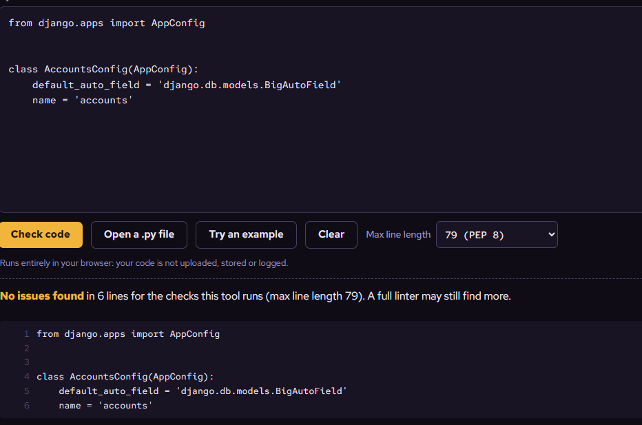

# Testing

[Return to README](README.md)

## HTML validation

Rendered pages were checked using the W3C Nu HTML Checker on
12 November 2026.

### Homepage

Result: no errors or warnings.


### Parts catalogue


### Product-detail page


### Login page


### Registration page — initial errors

The initial check found four HTML errors caused by invalid nesting
around the password-help list.


### Registration page — recheck after the fix

The signup template was updated to render fields and help text in div
elements instead of using form.as_p. All 15 authentication regression
tests passed after the change.


### Basket page


## CSS validation

`core/static/core/css/base.css` was checked using
the W3C CSS Validator with the CSS level 3 + SVG profile.

Result: no errors found.

Successful CSS validation for base.css

## JavaScript validation

`core/static/core/js/navigation.js` was checked using JSHint on
12 November 2026.

### Initial check — three warnings

JSHint reported two warnings about function declarations inside a block
and one about optional chaining requiring ES11 rather than ES6.


### Recheck after corrections

The two functions were converted to function expressions.
The JSHint configuration was updated to `esversion: 11` with
`browser: true`, matching the JavaScript features used.

Result: no warnings reported.


## Python style validation

The following accounts files were checked using [PEP8 Online](https://pep8online.com/)
with a maximum line length of 79 characters.

These screenshots document the checks performed by this tool.
Unused-import warnings from Flake8 are separate. Style checks do not
replace the Django automated tests.

### accounts/admin.py

Result: no issues reported by the online checker.


### accounts/apps.py

The initial check reported W391: an extra blank line at the end of
the file.


The extra blank line was removed while preserving a final newline.

Result after correction: no issues reported in 6 lines.



### accounts/models.py

The initial check reported W391: an extra blank line at the end of
the file.


The extra blank line was removed while preserving a final newline.

Result after correction: no issues reported in 3 lines.


### accounts/test_authentication.py

The initial check reported W391 at line 200: an extra blank line
at the end of the file.


The extra blank line was removed without changing the test logic.

Result after correction: no issues reported in 199 lines.


### accounts/tests.py

Result: no issues reported in 3 lines by the online checker.


### accounts/views.py

Result: no issues reported in 3 lines by the online checker.


### bimmerhub/asgi.py

Result: no issues reported in 16 lines.


### bimmerhub/urls.py

Result: no issues reported in 22 lines.


### bimmerhub/wsgi.py

Result: no issues reported in 16 lines.


### bimmerhub/settings.py

Checked locally with Flake8 as part of the complete project scan.
No issues reported.

### Complete project Python validation

Flake8 7.5.0 was run locally across all project
Python folders and manage.py, including settings and migrations:

```powershell
python -m flake8 accounts bimmerhub core garage parts payments manage.py --isolated --max-line-length=79 --statistics --count
```

The initial scan reported 52 issues: 34 long lines, 5 unused imports,
12 missing final newlines and 1 extra blank line at the end of a file.

After corrections, the scan reported 0 issues. Migration formatting
was verified to preserve the original Python structure.

All 218 Django automated tests passed after the changes.
Git's whitespace check reported no errors.